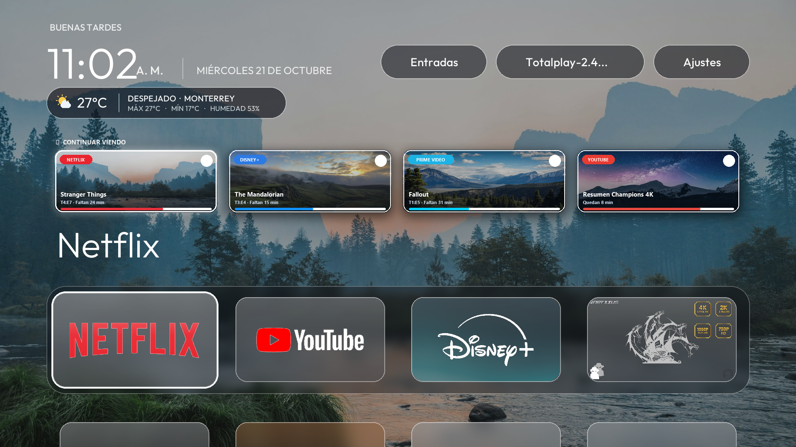
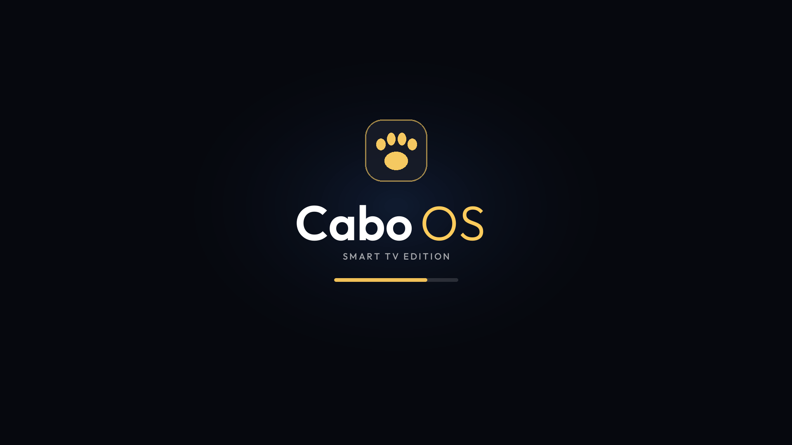
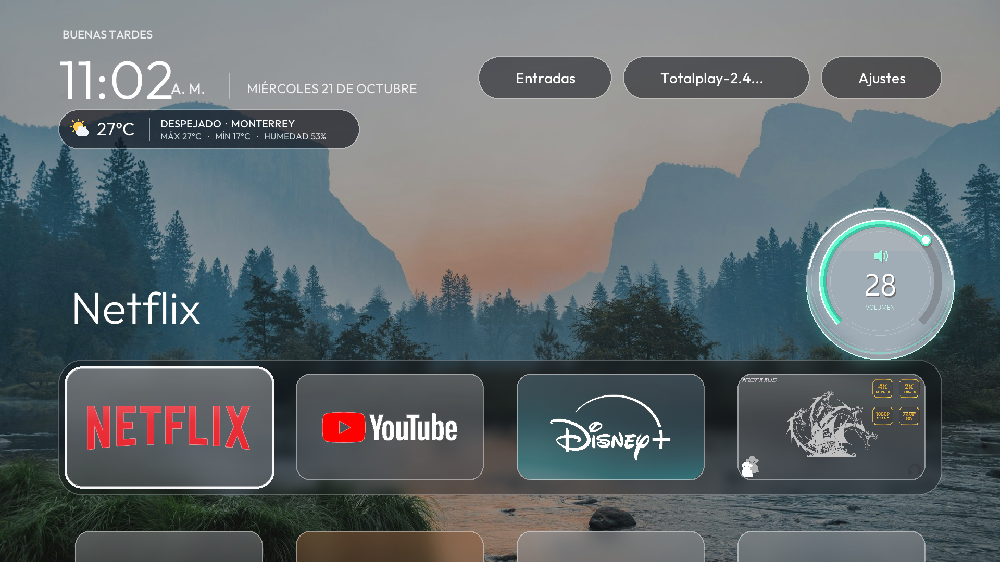
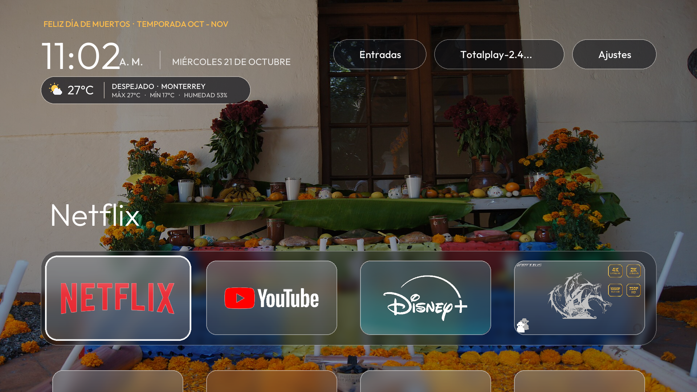
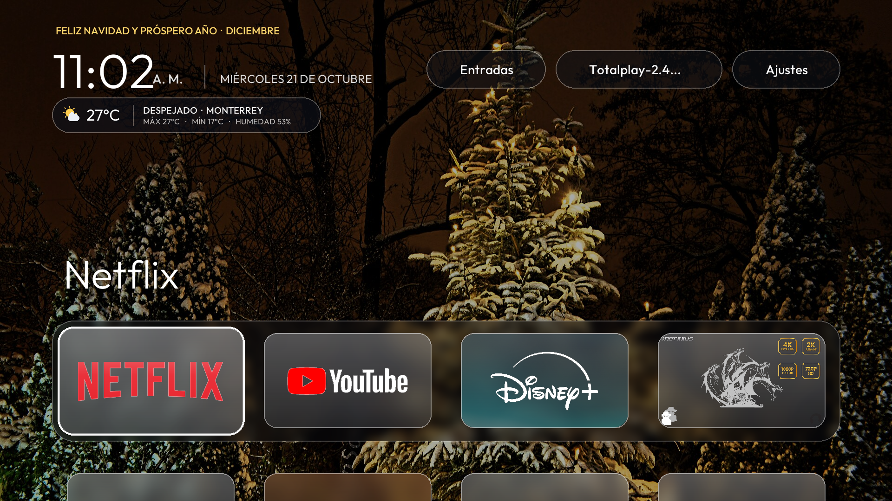

# 📺 CaboOS — Smart TV Edition (Android TV Launcher)

**Desarrollado y personalizado por [Eder Ugarte (@EderU99)](https://github.com/EderU99)**  
*TSU en Desarrollo de Software Multiplataforma*

---

## ✨ ¿Qué es CaboOS?

**CaboOS** es una evolución personalizada de launcher para **Android TV / Smart TV** (construida sobre la base abierta de *CleanYourTV*), diseñada para reemplazar la interfaz saturada de anuncios de fábrica por una experiencia visual **Glassmorphism**, rápida y moderna, desplegada de forma inalámbrica mediante **ADB**.

### 🚀 Características Principales Implementadas en CaboOS:
- **🎬 Pantalla de Inicio & Boot Splash (`CaboBootSplashView`):** Animación de arranque personalizada de CaboOS al encender o volver al inicio en la TV.
- **▶️ Fila Interactiva "Continuar Viendo" (`ContinueWatchingService` & `ContinueWatchingCardView`):** Seguimiento inteligente de las últimas aplicaciones y contenidos reproducidos con acceso directo en pantalla.
- **🌦️ Widget de Clima en Tiempo Real (`WeatherUpdater` & `WeatherIconView`):** Píldora translúcida superior con temperatura actualizada e íconos dinámicos.
- **🖼️ Fondos Rotativos y Temas por Temporada (`SeasonalWallpapers` & `WallpaperPlayer`):** Cambio dinámico de paisajes de alta definición y modos temáticos especiales (*Día de Muertos*, *Navidad / Invierno* y *Naturaleza*).
- **🔊 Control de Volumen 3D Cristalizado (`HomeKeyService`):** Intercepción por servicio de accesibilidad para mostrar un indicador de volumen lateral con acabado cristalizado en lugar del volumen genérico del sistema.
- **⚡ Instalador Inalámbrico Automatizado (`instalar_cabo_os.bat`):** Script en Batch/ADB para instalar la APK compilada, asignarla como *Home Launcher* y activar los servicios de accesibilidad en un solo paso por red local.

---

## 📸 Capturas de Pantalla (CaboOS en Acción)

### 1. Interfaz Principal con Fila "Continuar Viendo" y Efecto Cristal

### 2. Pantalla de Arranque (CaboOS Boot Splash)

### 3. Control de Volumen Lateral Cristalizado 3D

### 4. Temas Estacionales (Día de Muertos & Navidad)
| Tema Día de Muertos | Tema Navidad / Invierno |
| :---: | :---: |
|  |  |

---

## 🛠️ Stack Tecnológico y Estructura del Código

- **Lenguaje Nativo:** Java (Android SDK)
- **Componentes creados/modificados en `launcher/app/src/main/java/com/gathin/tvhome/`:**
  - `MainActivity.java` — Orquestación principal del Launcher, grilla de apps y widgets.
  - `CaboBootSplashView.java` — Animación de bienvenida de CaboOS.
  - `ContinueWatchingService.java`, `ContinueWatchingStore.java`, `ContinueWatchingCardView.java` — Motor y UI de *Continuar viendo*.
  - `WeatherUpdater.java` & `WeatherIconView.java` — Consulta y renderizado del clima en vivo.
  - `SeasonalWallpapers.java` & `WallpaperPlayer.java` — Motor de fondos dinámicos y estacionales.
  - `GlassBanner.java` — Componentes visuales con efecto *Glassmorphism*.
  - `HomeKeyService.java` — Servicio de accesibilidad para atajos del control remoto y volumen 3D.
- **Automatización y Despliegue:** `instalar_cabo_os.bat` & `restaurar-tv.ps1` (ADB sobre Wi-Fi / PowerShell).

---

## 📦 Instalación Rápida en Smart TV (ADB Inalámbrico)

1. Activa la **Depuración Inalámbrica** en las *Opciones de Desarrollador* de tu Android TV / Google TV.
2. Ejecuta `instalar_cabo_os.bat` desde Windows.
3. Ingresa el puerto mostrado en tu TV: el script conectará por ADB, instalará la APK de **CaboOS** y activará automáticamente la interfaz y el servicio de accesibilidad.

---
*Proyecto basado originalmente en [CleanYourTV](https://github.com/Gathin23/cleanyourtv) bajo licencia MIT, expandido y personalizado con las funcionalidades de **CaboOS Smart TV Edition** por **Eder Ugarte**.*
